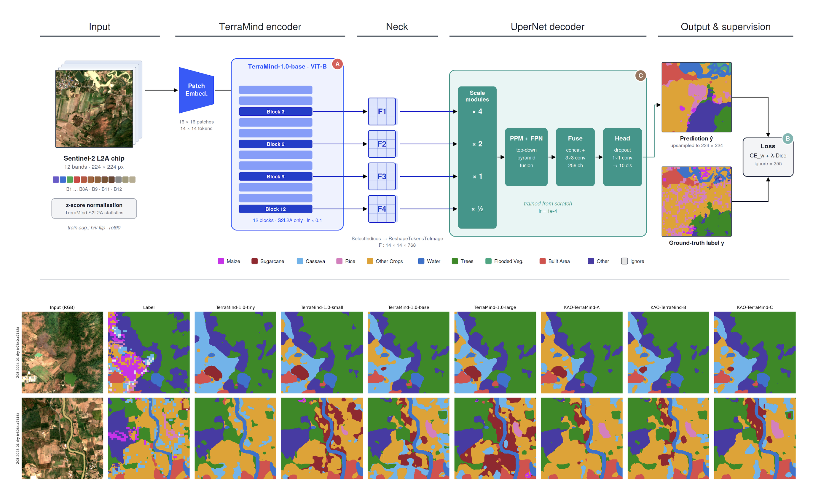
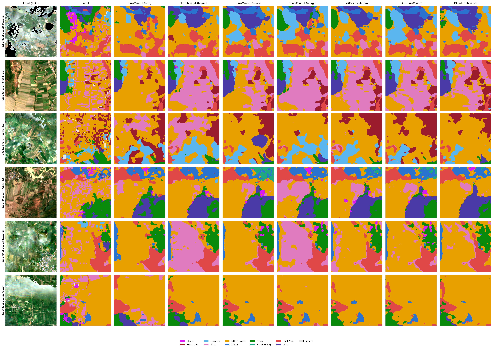

<div align="center">

# 🛰️ KAO-TerraMind

### Targeted Adaptation of Geospatial Foundation Models for Dense Prediction

**Teerapong Panboonyuen (Kao)**

*Preparing for Submission to the IEEE/CVF Conference on Computer Vision and Pattern Recognition (CVPR 2027)*

[-1f6feb)](#citation)
[](https://huggingface.co/kaopanboonyuen/KAO-TerraMind-A)
[](https://huggingface.co/kaopanboonyuen/KAO-TerraMind-B)
[](https://huggingface.co/kaopanboonyuen/KAO-TerraMind-C)
[](#dataset)

</div>

<p align="center">
  
</p>

> **Figure 1.** KAO-TerraMind pipeline. A 12-band Sentinel-2 L2A chip is tokenised and encoded by TerraMind-1.0-base; features from four transformer blocks are reshaped into a pyramid and decoded by UperNet into a 10-class land-cover map. Badges **A**, **B**, **C** mark the single component each variant changes.

---

## Overview

Geospatial foundation models such as [TerraMind](https://arxiv.org/abs/2504.11171) are pre-trained on large multimodal Earth-observation corpora, yet fine-tuning them for single-modality dense prediction often relies on default recipes.

**KAO-TerraMind** studies *targeted adaptation*: three variants of **TerraMind-1.0-base**, each introducing **one controlled change** (optimisation, objective, or decoder). Every other factor (data, seed, schedule, sampler, batch size) is identical, so each gain is attributable. All variants are benchmarked against TerraMind-1.0 tiny / small / base / large on a 10-class crop and land-cover dataset over Thailand.

**Highlights**

- **KAO-TerraMind-C reaches 41.13% mIoU and 78.90% overall accuracy**, ahead of TerraMind-large (40.13% mIoU, 76.34% OA) with about **38% of its parameters** (121.7M vs 320.2M) and higher throughput (132.5 vs 92.2 img/s on a Tesla T4).
- **Three single-factor variants** of TerraMind-1.0-base: A (optimisation), B (objective), C (decoder).
- **Fair, reproducible benchmark**: seven models, one protocol, 13,974 test chips, with cost, speed and memory reported.
- **Open release**: code in this repository and three pretrained checkpoints on Hugging Face.

---

## Variants

| Variant | Component | Change (default → ours) | Rationale |
|---|---|---|---|
| **KAO-TerraMind-A** | Optimisation | backbone lr multiplier ×0.1 → **×0.3**; weight decay 0.01 → **0.05** | Adapt the pre-trained encoder more strongly to the target domain |
| **KAO-TerraMind-B** | Objective | Dice weight λ 0.5 → **1.0** (CE with √inverse-frequency class weights + Dice) | Emphasise overlap for rare crop classes |
| **KAO-TerraMind-C** | Decoder | UperNet channels 256 → **512**; head dropout 0.1 → **0.2**; feature taps (blocks) 3·6·9·12 → **4·7·10·12** | Wider decoder with deeper-biased features |

Shared settings: TerraMind-1.0-base backbone (S2L2A modality only), UperNet decoder, 10 classes + ignore label (255), seed 42, 30 epochs, batch size 16, class-balanced sampler, identical train / validation / test chips.

| Weights | Hugging Face |
|---|---|
| KAO-TerraMind-A | [`kaopanboonyuen/KAO-TerraMind-A`](https://huggingface.co/kaopanboonyuen/KAO-TerraMind-A) |
| KAO-TerraMind-B | [`kaopanboonyuen/KAO-TerraMind-B`](https://huggingface.co/kaopanboonyuen/KAO-TerraMind-B) |
| KAO-TerraMind-C | [`kaopanboonyuen/KAO-TerraMind-C`](https://huggingface.co/kaopanboonyuen/KAO-TerraMind-C) |

---

## Results

All models were fine-tuned and tested on the same 13,974 chips (Tesla T4, fp16 autocast). Best value per column in **bold**.

| Model | Params (M) | GFLOPs | OA (%) | mIoU (%) | F1 macro (%) | Kappa | mAP (%) | Latency (ms) | Throughput (img/s) |
|---|---:|---:|---:|---:|---:|---:|---:|---:|---:|
| TerraMind-1.0-tiny | 13.31 | 22.84 | 75.00 | 37.18 | 48.61 | 0.6534 | 49.31 | 15.09 | **538.8** |
| TerraMind-1.0-small | 31.08 | 30.11 | 77.75 | 39.05 | 50.58 | 0.6861 | 50.85 | 14.13 | 415.5 |
| TerraMind-1.0-base | 99.37 | 57.66 | 78.44 | 40.82 | 52.57 | 0.6982 | 52.63 | 15.15 | 245.8 |
| TerraMind-1.0-large | 320.22 | 146.71 | 76.34 | 40.13 | 52.04 | 0.6753 | 52.70 | 24.95 | 92.2 |
| KAO-TerraMind-A | 99.37 | 57.66 | 78.61 | 40.81 | 52.48 | 0.6996 | 52.69 | 15.16 | 245.6 |
| KAO-TerraMind-B | 99.37 | 57.66 | 78.31 | 40.97 | 52.74 | 0.6965 | 52.76 | 19.65 | 246.0 |
| **KAO-TerraMind-C** | 121.74 | 118.06 | **78.90** | **41.13** | **52.80** | **0.7036** | **53.03** | 19.39 | 132.5 |

**Notes.** The gains over TerraMind-base are modest (C: +0.31 mIoU, +0.46 OA) and come with a trade-off: the wider decoder roughly doubles GFLOPs (118.06 vs 57.66) and lowers throughput (132.5 vs 245.8 img/s). Variant A is on par with the base model in mIoU (40.81 vs 40.82). Full metrics are written to `results/metrics_summary.csv`.

<p align="center">
  
</p>

> **Figure 2.** Qualitative predictions: input (RGB), ground-truth label, and the outputs of TerraMind-1.0 (tiny / small / base / large) and KAO-TerraMind (A / B / C).

---

## Dataset

Experiments use a **10-class crop and land-cover dataset over Thailand**, supported by the **Geo-Informatics and Space Technology Development Agency (GISTDA), Thailand**.

| Item | Value |
|---|---|
| Source imagery | Sentinel-2 L2A |
| Chip size | 224 × 224 pixels |
| Bands | 12 (B1, B2, B3, B4, B5, B6, B7, B8, B8A, B9, B11, B12) |
| Seasons | dry (January) and wet (August) scenes across several zones |
| Split | spatial train / validation / test |
| Test set | 13,974 chips |
| Classes | Maize, Sugarcane, Cassava, Rice, Other Crops, Water, Trees, Flooded Vegetation, Built Area, Other (+ ignore = 255) |

Inputs are z-score normalised with TerraMind's S2L2A pre-training statistics. Training augmentation: random horizontal / vertical flip and 90° rotation.

> ### 🙏 Acknowledgement
> We sincerely thank the **Geo-Informatics and Space Technology Development Agency (GISTDA), Thailand** ([gistda.or.th](https://www.gistda.or.th/)) for supporting the dataset used in this work. Their Earth-observation expertise and data made the training and evaluation of KAO-TerraMind possible.

---

## Installation

```bash
git clone https://github.com/kaopanboonyuen/KAO-TerraMind.git
cd KAO-TerraMind

pip install "terratorch>=1.2.4" "diffusers==0.30.0" rasterio pandas matplotlib tqdm
```

A single NVIDIA GPU is sufficient (all experiments were run on a Tesla T4, 16 GB). Pre-trained TerraMind weights are downloaded automatically from Hugging Face (`ibm-esa-geospatial/TerraMind-1.0-*`) into `hf_cache/`.

---

## Usage

### 1. Prepare the data

Chips must be 12-band 224 × 224 GeoTIFFs with matching masks, split spatially into train / val / test. Point `--data-root` (or `DATA_ROOT`) to the folder that contains them.

### 2. Train and evaluate (one command)

```bash
export WANDB_API_KEY='...'                 # optional; use ALLOW_NO_WANDB=1 to skip
DATA_ROOT=/path/to/terramind_data bash run_all.sh
```

`run_all.sh` creates one `RUN_ID`, trains tiny → small → base → large and the KAO variants, retries on crashes and **resumes** from the last epoch. Extra flags are passed through:

```bash
bash run_all.sh --epochs 40 --models base large
```

Or call the script directly:

```bash
python finetune_terramind.py --data-root /path/to/terramind_data                 # all models
python finetune_terramind.py --data-root /path/to/terramind_data --models kaoA kaoB kaoC
python finetune_terramind.py --data-root /path/to/terramind_data --smoke          # 5-minute sanity check
python finetune_terramind.py --stage report                                       # rebuild tables and figures only
```

Model keys: `tiny`, `small`, `base`, `large` (baselines) and `kaoA`, `kaoB`, `kaoC`.

### 3. Inference on a full Sentinel-2 scene

Download a checkpoint from the Hugging Face model pages above, then:

```bash
python finetune_terramind.py --stage predict \
    --ckpt path/to/terramind_v1_base_best.pt \
    --input S2_scene.tif \
    --output prediction.tif
```

The input GeoTIFF must contain the 12 Sentinel-2 L2A bands (first 12 bands used). The output is a single-band `uint8` GeoTIFF with class ids `0–9` (255 = ignore):

`0 Maize · 1 Sugarcane · 2 Cassava · 3 Rice · 4 Other Crops · 5 Water · 6 Trees · 7 Flooded Veg. · 8 Built Area · 9 Other`

### Outputs

| Path | Content |
|---|---|
| `weights/runs/<RUN_ID>/` | versioned checkpoints (`weights/latest/` = newest finished run, `weights/registry.json` = index) |
| `results/metrics_summary.csv` · `.md` | full metrics for every model |
| `results/paper_table_*.tex` | LaTeX tables for the paper |
| `results/per_class_*.csv` | per-class F1 / IoU |
| `results/figures/*.png` · `*.pdf` | training curves, confusion matrices, PR curves, qualitative galleries |
| `results/OUTPUT_CHECKLIST.txt` | which expected outputs exist |

---

## Repository structure

```
KAO-TerraMind/
├── finetune_terramind.py     # training, evaluation, reporting, inference
├── run_all.sh                # one-command, resumable run
├── index.html                # project page
├── kaoterramind-img/         # figures used by the page and this README
├── weights/                  # fine-tuned checkpoints (versioned)
├── results/                  # tables and figures
└── README.md
```

---

## Citation

If you use KAO-TerraMind, please cite this work **and** the original TerraMind paper.

```bibtex
@article{panboonyuen2026kaoterramind,
  title   = {KaoTerraMind: Targeted Adaptation of Geospatial Foundation Models for Dense Prediction},
  author  = {Panboonyuen, Teerapong},
  year    = {2026},
  note    = {Manuscript in preparation for submission to CVPR 2027},
  url     = {https://github.com/kaopanboonyuen/KAO-TerraMind}
}

@inproceedings{jakubik2025terramind,
  title        = {Terramind: Large-scale generative multimodality for earth observation},
  author       = {Jakubik, Johannes and Yang, Felix and Blumenstiel, Benedikt and Scheurer, Erik and Sedona, Rocco and Maurogiovanni, Stefano and Bosmans, Jente and Dionelis, Nikolaos and Marsocci, Valerio and Kopp, Niklas and others},
  booktitle    = {2025 IEEE/CVF International Conference on Computer Vision (ICCV)},
  pages        = {7383--7394},
  year         = {2025},
  organization = {IEEE}
}
```

---

## Acknowledgements

- **GISTDA, Thailand**, for supporting the dataset used in this work.
- The **TerraMind** authors (IBM, ESA Φ-lab and collaborators) for the pre-trained foundation models.
- **[TerraTorch](https://github.com/IBM/terratorch)** for the fine-tuning toolkit, and **Sentinel-2** (Copernicus / ESA) for the imagery.

## Authorship notice

KAO-TerraMind (A, B, C) is the original work of **Teerapong Panboonyuen**, © 2026. Any use, derivative, benchmark or publication that builds on these models or this repository must credit the author and cite both papers above.

## License

*TODO: add a LICENSE file and state it here before making the repository public (note that TerraMind weights and the GISTDA dataset have their own terms).*